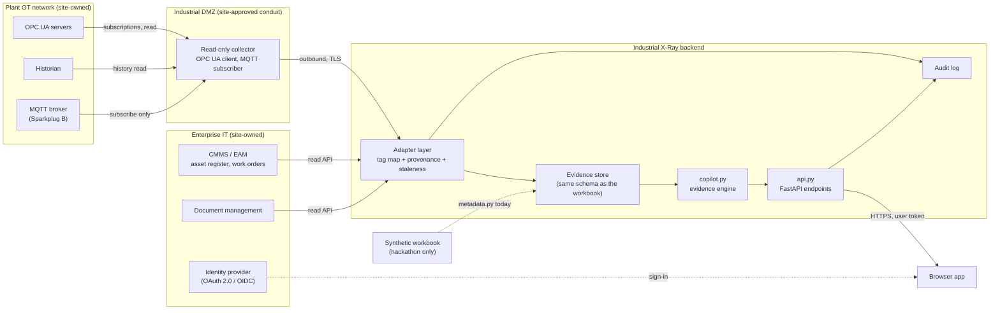

# Data integration: how read-only plant data could be connected later

Status: design note, written on 2026-11-07. **Nothing in this document is built.**

## 0. What the hackathon build uses

* The only asset data source is the **synthetic** Valmet × Since AI builder pack (`builder_pack.xlsx`, 14 sheets).
  All 30 assets have `data_classification = SYNTHETIC`, and every sheet has a `synthetic_record` column.
* There is **no live plant data, no network connection to any plant system and no control connection**. The work-order
  endpoint returns a draft only (`"control_actions": "none (draft only)"` in `backend/xray/api.py`).
* The workbook's `connectivity_profile` column names protocols per asset (OPC_UA 11, MQTT_EDGE 7, SIMULATED_API 7,
  FOUNDATION_FIELDBUS 3, HART 2). These are **synthetic labels**. Nothing is connected to them.
* Valmet mentioned industrial data from power plants and its distributed control system, **Valmet DNAe**. This document
  stays generic: every interface below must be checked against the site's real systems. How the prototype could later
  complement DNAe through authorised, read-only access, using only what Valmet's public pages state, is in
  [DNAE_ALIGNMENT.md](DNAE_ALIGNMENT.md). The prototype does not connect to DNAe.

This note answers the workbook's builder question **Q-07**: "Replace synthetic feeds with OPC UA/MQTT/API sources
without redesigning the product."

## 1. Principles

1. **Read-only everywhere.** No write, method call or command path exists in the design, at any layer. It is
   enforced on the source side (accounts, roles, broker rules, firewall), not only in our code.
2. **Same evidence schema.** Adapters produce the same records the workbook provides today. The copilot, the API and
   the front end do not change.
3. **Every value carries provenance.** Where it came from, when it was measured, when we received it, and whether it
   is synthetic, replayed or live.
4. **Stale or poor-quality data lowers confidence.** It is never silently treated as current.

## 2. Architecture

There is no arrow from our side back into OT or IT systems. The work-order draft stays in our app and a planner
copies it into the CMMS by hand.

## 3. Sources

| Source | What we read | How (read-only) | Becomes (workbook sheet it replaces) |
|---|---|---|---|
| **OPC UA** | Current values, status codes, alarms and conditions | A client creates Subscriptions with MonitoredItems and uses Read. It never calls Write or Call. The server-side user is granted only browse, read, read-history and receive-events permissions. Security mode `SignAndEncrypt` with application certificates ([OPC UA reference](https://reference.opcfoundation.org/), Part 2 security model, Part 4 services) | `Current_State`, `Telemetry_Sample_3d`, `Alarms_Events` |
| **Historian** | Time series for baselines and trends (the copilot compares the last 12 h with the first 24 h and with peers) | Vendor read API, or OPC UA HistoryRead, through a read-only account; pull with bounded time windows | `Telemetry_Sample_3d` |
| **MQTT / Sparkplug B** | Edge metrics | Subscribe to `spBv1.0/<group>/NDATA/...`, `DDATA`, `NBIRTH`, `DBIRTH`, `NDEATH`, `DDEATH`. The broker's access rules deny our client any publish, in particular to the command topics `NCMD` / `DCMD`. TLS with a client certificate ([Sparkplug](https://sparkplug.eclipse.org/), [spec PDF](https://www.eclipse.org/tahu/spec/sparkplug_spec.pdf), [MQTT](https://mqtt.org/mqtt-specification/)) | `Telemetry_Sample_3d`, data-quality events (a DEATH message marks values stale) |
| **CMMS / EAM** | Asset register, functional locations, work orders, maintenance history | Read API with a service account limited to reading. Polling or change feed | `Asset_Master`, `Maintenance_History`, `Historical_Service_Cases` |
| **Document management** | Manuals, procedures, drawings, with document number and revision | Read API; we store ids, revisions and text extracts for retrieval, and link back to the source | `Knowledge_Docs`, `RAG_Corpus_Index` |

Protocol details above (service names, Sparkplug topics) are from the cited specifications as summarised in our search
results. Confirm them against the versions the site runs.

## 4. Adapter layer

One adapter per source. Each adapter does three things:

1. **Fetch** from its source, read-only.
2. **Map** external identifiers to our asset ids, using a reviewed mapping table:

   | Column | Example (illustrative) |
   |---|---|
   | `asset_id` (ours, from `Asset_Master`) | `ASSET-017` |
   | `tag` | `P-005` |
   | `source_system` | `opcua:<server-name>` |
   | `external_ref` | an OPC UA NodeId, a Sparkplug `group/edge/device/metric` path, a CMMS asset number or a document number |
   | `signal` (our name, from `SIGNALS` in `metadata.py`) | `motor_current_a` |
   | `unit`, `scale` | `A`, `1.0` |
   | `expected_interval_s` | used for staleness |
   | `scene_object_id` | from the binding made by `mapping.py`, or confirmed in the field by QR/NFC |
   | `mapping_status`, `reviewed_by`, `reviewed_at` | review trail |

   The link from asset to scene object stays where it is today: `mapping.py` binds assets to scene objects and stores
   `method` and `mapping_confidence`. The workbook's `Scene_Anchors` sheet already marks the anchors as
   `placeholder_until_valmet_scene_received`. Field confirmation by QR or NFC (`qr_id`, `nfc_id` in `Asset_Master`)
   would raise the mapping confidence.
3. **Normalise** into the evidence schema below and attach provenance.

Unmapped tags are logged and not shown. A tag that maps to two assets is rejected until a person resolves it.

## 5. Provenance labels

Every record the copilot sees gets these fields (the first is already present today as `synthetic_record`):

| Field | Meaning |
|---|---|
| `provenance` | `synthetic` (workbook), `replay` (recorded real data played back) or `live` |
| `source_system`, `external_ref` | where the value came from |
| `observed_at` | source timestamp (when it was measured or written) |
| `received_at` | when our adapter got it |
| `quality` | source quality, for example the OPC UA status code (Good / Uncertain / Bad) |
| `stale` | `true` when `now − observed_at` exceeds `expected_interval_s × k` (k set per site), or after a Sparkplug DEATH |
| `adapter_version` | for audits |

How this reaches the user:
* The UI shows a badge on every value and on every diagnosis: **SYNTHETIC**, **REPLAY** or **LIVE**, plus the age of
  the newest value. A diagnosis mixing kinds says so.
* Stale or bad-quality values become entries in the same structure as the workbook's `Data_Quality` sheet. The
  copilot already lowers confidence for data-quality issues (`dq_pen` in `Copilot.evidence`), so stale data lowers the
  shown confidence without new logic.
* The current `synthetic_notice` in the evidence package becomes a provenance summary.

## 6. What stays the same in our code

| Module | Today | With live adapters |
|---|---|---|
| `backend/xray/metadata.py` | `BuilderPack` reads the workbook sheets (`Asset_Master`, `Current_State`, `Telemetry_Sample_3d`, `Alarms_Events`, `Maintenance_History`, `Historical_Service_Cases`, `Knowledge_Docs`, `RAG_Corpus_Index`, `Data_Quality`, `Scene_Anchors`) and exposes them as tables; also `telemetry_evidence` and `priority_score` | **The one module that changes.** A second class with the same properties (`assets`, `telemetry`, `events`, `work_orders`, `cases`, `docs`, `rag_index`, `data_quality`, `anchors`, `asset()`) reads from the evidence store instead of Excel. `world.py` (which creates `BuilderPack` today) would pick the class from `config/project.json` |
| `backend/xray/copilot.py` | `Copilot.evidence()` builds the evidence package; `valid_ids()` and the citation checker allow only ids from that package; confidence formula; template or LLM narration | Unchanged. It consumes the same records. Provenance fields pass through to the UI |
| `backend/xray/mapping.py` | Binds assets to scene objects with `method` and `mapping_confidence` | Unchanged; field confirmations come in as overrides |
| `backend/xray/api.py` | `GET /api/assets`, `/api/assets/{id}`, `/api/assets/{id}/telemetry`, `/events`, `/documents`, `GET /api/scene/anchors`, `GET /api/diagnose/{id}`, `POST /api/copilot/query`, `POST /api/copilot/command`, `GET /api/knowledge/search`, `POST /api/work-orders/draft` (draft only) | Same routes and response shapes (the workbook's `API_Contract`). Add authentication and audit logging. The draft endpoint stays a draft |
| Front end (`web/`) | Calls the API | Unchanged, plus provenance badges |

`docs/ARCHITECTURE.md` §10 states the same intent: swap `metadata.py` for adapters without changing the API.

## 7. Security

| Control | Design |
|---|---|
| Reference framework | ISA/IEC 62443 series ([ISA overview](https://www.isa.org/standards-and-publications/isa-standards/isa-iec-62443-series-of-standards)): zones and conduits, a target security level per zone, asset inventory and risk assessment first. We use it as a **reference**; we do not claim compliance. The site's own OT security policy decides |
| Network segmentation | Our backend never sits in the control network. A collector in an industrial DMZ is the only component that talks to OT sources, through an approved conduit. Connections go **out** from the DMZ to our backend; nothing connects inward to OT |
| No write path | OPC UA user without write or method-call rights; MQTT client without publish rights; CMMS and document accounts read-only. Our code has no write calls. A firewall rule blocks anything else |
| Least privilege | One service account per source, limited to the tags, assets and documents in the mapping table. Credentials in a secret store, rotated |
| Users | Sign-in through the site's identity provider with OAuth 2.0 / OpenID Connect ([RFC 6749](https://datatracker.ietf.org/doc/html/rfc6749), [OIDC Core](https://openid.net/specs/openid-connect-core-1_0.html)). Roles such as viewer, technician, planner; the API checks the token on every call |
| Transport | TLS everywhere; OPC UA `SignAndEncrypt`; MQTT over TLS with client certificates |
| Audit logging | Log who viewed which asset and diagnosis, every adapter fetch (source, time, record count), every mapping change and every work-order draft. Append-only, kept per the site's retention rule |
| LLM use | Only the evidence package is sent to the model, and only if the site allows it; otherwise the template mode runs (already supported when no API key is set). The model can never cause an action |
| Data classification | Plant data stays in the region and tenancy the site approves. Scan geometry of a plant is sensitive and is handled the same way |

## 8. Why browser-based: claims to test, not facts

We have **not** measured any of these against the tool Valmet uses today (described to us as similar to Unity). We do
not claim our approach is faster or cheaper. These are hypotheses for a pilot.

| Claimed advantage | Hypothesis | How to measure fairly |
|---|---|---|
| No install | A technician on a managed laptop or tablet can open the scene without installing software or raising an IT request | Count steps, IT tickets and elapsed time from "receive link" to "scene visible" for new users on the site's standard devices, for both tools. Include first-time setup of the current tool |
| Link sharing | A remote expert can open the same asset, view and diagnosis from one link | Time from "expert asked" to "expert looking at the same object", and share of attempts that succeed, on the site's real network, for both tools |
| Startup time | Time to first view and time until the user can interact are acceptable on typical devices | Same scene, same devices, same network, cold and warm cache; at least 10 runs each; report median and spread. Run the current tool in its recommended configuration, set up by its own experts |
| Cost | Lower total cost per site per year | Licences, hosting, devices, **content preparation hours per site** (capture, processing, labelling, review) and maintenance, for both tools, for the same set of sites and use cases |

Known risks of the browser approach to measure at the same time: GPU limits on low-end devices (we already fall back
to a 2D plan without WebGL 2), very large scenes, offline use on site, browser security policies, and headset support.

Rules for a fair comparison: the same tasks (explore, identify, locate, understand, plan, rehearse, get remote
support), done by real technicians, measured by someone outside our team, with results published whether or not they
favour us.

## 9. Open questions for Valmet

1. Which systems hold the asset register, work orders, condition data and documents at a pilot site? (For Valmet DNAe
   sites, see the questions in [DNAE_ALIGNMENT.md](DNAE_ALIGNMENT.md) §6.)
2. Is a read-only OPC UA account or MQTT subscription through an existing DMZ possible, or only exported files at first?
3. Which identity provider should users sign in with?
4. Can the pilot start with **replayed** real data (exported files) before any live connection?
5. Is sending evidence text to an external LLM allowed, or must narration run locally or stay in template mode?
